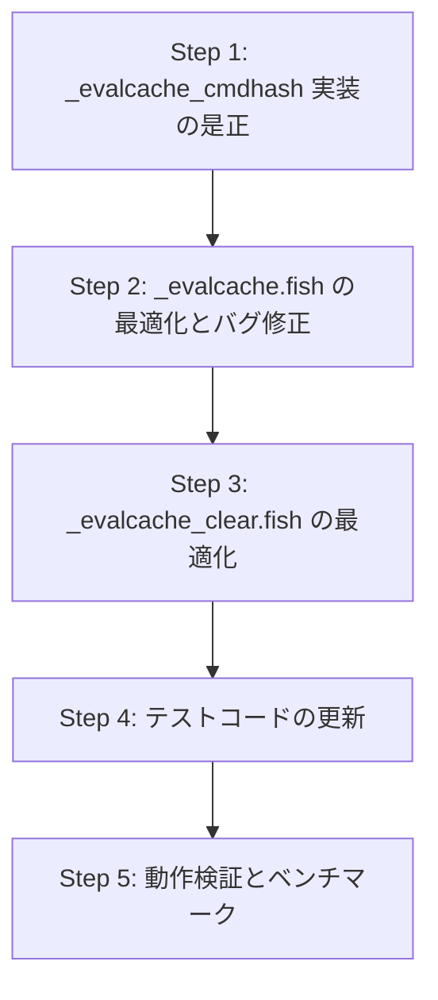

# evalcache 最適化計画 実装修正プラン

対象リポジトリ: `kyohsuke/fish-evalcache`  
参照計画書: `plans/optimize_plan.md`

---

## 1. 背景と現状の課題

`plans/optimize_plan.md` に基づく先行実装（未コミットの変更）を検証した結果、以下の重大な問題および未実装項目が確認された。

### 1.1 現状の実装における重大な問題

1. **`functions/_evalcache_cmdhash.fish` の構文・動作エラー**
   - **`math` 評価エラー (`0x$char`)**:
     `string split '' $data` で得られる1文字を `0x$char` として `math` に渡しているため、16進数（0-9, a-f）以外の文字（`.`, `/`, `t` など）で `math: Error: Unknown function` 等のシンタックスエラーが発生し、ハッシュ計算が完全に失敗する。
   - **関数の戻り値誤り (`return` vs `echo`)**:
     `return $result` は終了ステータス `$status`（0-255）を設定するのみで、標準出力に値を出力しない。呼び出し側 `set -f cmdHash (_evalcache_cmdhash $argv)`（コマンド置換）では空文字列になってしまう。
   - **アルゴリズムの相違**:
     コメントでは `Jenkins one-at-a-time hash` と記載されているが、実装コード（初期値 `5381`, `* 33`）は **djb2** である。

2. **多段ループによるパフォーマンス劣化の懸念**
   - fish スクリプト内で 1 文字ずつループを回して毎文字ごとに `math` builtin を呼び出す構造は、長い引数列において外部コマンド 1 回の fork よりも大幅に実行時間が増大するリスクがある。

3. **計画書記載の最適化・バグ修正項目の未実装**
   - **`basename` 外部コマンド排除**: 未着手（`functions/_evalcache.fish`, `functions/_evalcache_clear.fish`）。
   - **空出力対応 (`test -s` → `test -f`)**: 未着手（`functions/_evalcache.fish`）。
   - **`FISH_EVALCACHE_DISABLE` 時の実行構文**: 未着手（`eval ($argv | source)` のまま）。
   - **キャッシュ削除 (`rm -f`) の fork 削減**: 未着手。
   - **テストコード (`tests/*.fish`) の追従**: 未着手。

---

## 2. 修正方針

### 2.1 ハッシュ計算の現実的・確実な最適化
- **推奨案（単一プロセス + fish builtin による抽出）**:
  - シェル内での 1 文字単位ループは fish の言語特性上オーバーヘッドが大きいため、外部コマンドの fork 数を最小化する。
  - macOS では `md5 -q -s "$argv"`, Linux では `md5sum` を 1 プロセスのみ実行。
  - パイプライン（`cut` 等）は廃止し、fish 組み込みの `string split -f1 ' '` または `string match -r '[0-9a-fA-F]+'` でハッシュ値を抽出する。
  - コマンド不在時は安全なフォールバック値を返す。
  - 値は `echo` または `printf` で標準出力に出力する。
- **代替案（fish ネイティブ Jenkins / djb2）を採用する場合の条件**:
  - `printf '%d' "'$char"` による文字コード取得が必要となるが、ベンチマークで外部コマンド1回呼び出しより高速であることが実証された場合のみ採用する。

### 2.2 `basename` の fish builtin 化
- fish 3.5.0 以降で導入された builtin `path basename $argv[1]` を使用する。
- これにより hot path から `/usr/bin/basename` の fork/exec を完全に排除する。
- 互換性を高める場合は `string replace -r '^.*/' '' -- $argv[1]` も検討可能。

### 2.3 潜在バグの修正
- **空出力コマンドのキャッシュ対応**: `test -s "$cacheFile"` を `test -f "$cacheFile"`（または `test -e`）に変更。
- **DISABLE 分岐の修正**: `eval ($argv | source)` を意図通りに動作する形式（`$argv | source`）へ修正。

### 2.4 キャッシュ削除処理の最適化
- 差分引数キャッシュの削除ループでの `basename` 呼び出しを `path basename` に変更、または `rm` をまとめて呼び出す構成に整理。

### 2.5 テストの更新
- `tests/_evalcache.fish`, `tests/_evalcache_clear.fish` のキャッシュファイル名検証コードを、新しいハッシュ生成仕様に合わせて更新。

---

## 3. 具体的な実装手順



### Step 1: `functions/_evalcache_cmdhash.fish` の是正
- 壊れている djb2 実装を破棄し、単一プロセス+fish builtin による安全かつ高速な実装に変更。
- 例:
  ```fish
  function _evalcache_cmdhash
      set -l data (string join " " $argv)
      if command -v md5 >/dev/null
          # macOS md5 command supports -q -s
          command md5 -q -s "$data"
      else if command -v md5sum >/dev/null
          # Linux md5sum output: "<hash>  -"
          set -l out (echo -n "$data" | command md5sum)
          string split -f1 " " $out
      else
          # Fallback when no md5 tool is available
          string replace -ra '[^a-zA-Z0-9_-]' '_' "$data"
      end
  end
  ```

### Step 2: `functions/_evalcache.fish` の最適化とバグ修正
1. `set -f cmd (basename $argv[1])` → `set -f cmd (path basename $argv[1])`
2. `eval ($argv | source)` → `$argv | source`
3. `else if test -s "$cacheFile"` → `else if test -f "$cacheFile"`
4. 引数違い削除ループ内の `basename` を `path basename` に変更。

### Step 3: `functions/_evalcache_clear.fish` の最適化
1. `set -f cmd (basename $argv[1])` → `set -f cmd (path basename $argv[1])`

### Step 4: `tests/*.fish` の更新
- `tests/_evalcache.fish` および `tests/_evalcache_clear.fish` で期待値生成に使用されている `echo -n ... | md5sum | cut -d' ' -f1` を、`_evalcache_cmdhash` の呼び出しまたは同等の処理に更新。
- 空出力コマンド（例: 出力のないスクリプト）のキャッシュヒットに関するテストケースの追加を検討。

### Step 5: 動作検証とベンチマーク
- fishtape によるユニットテストの実行確認。
- シェル起動時間（`fish -c "_evalcache ..."`）の計測による性能評価。
- CI（GitHub Actions）の通過確認。

---

## 4. リスクと対策

| リスク | 影響度 | 対策 |
|---|---|---|
| fish のバージョン互換性 | 低〜中 | `path` builtin は fish 3.5.0+ で利用可能。CI および対象環境の fish バージョンを確認（fish 3.5+ であれば問題なし。古いバージョンをサポートする場合は `string` で置換）。 |
| キャッシュキーの非互換 | 低 | キャッシュファイル名が変更されても初回実行時に再生成されるため、運用上の実害は極めて軽微。 |
| macOS / Linux 間の md5 オプション差異 | 中 | `md5 -q -s` (macOS/BSD) と `md5sum` (Linux/coreutils) の分岐を確実に網羅する。 |
